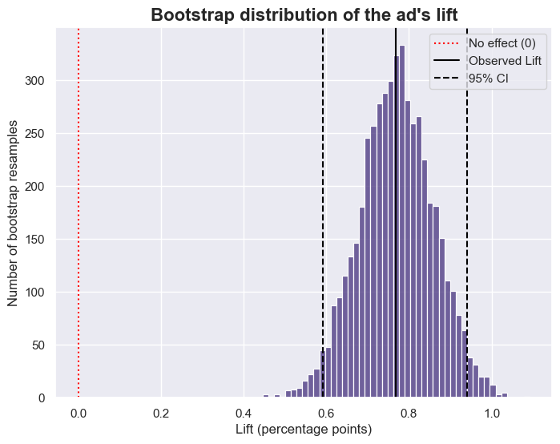

# Analyzing an Unbalanced A/B Test: Attributed vs. Incremental Conversions

> **Status: work in progress.**

Ad platforms count every conversion that follows an ad as caused by it, which overstates what a campaign earned and leads to overspending. A platform's conversion count and the ad's causal effect are different quantities, and the gap between them is where budget decisions go wrong. This project measures that gap on a real randomized experiment (588,101 users, ad vs. a public-service-announcement control) and analyzes it carefully: the control group is only 4% of users, so the analysis has to account for what that does to precision and what the data can and cannot show.

## Approach
- **Clean and check:** no missing values and no duplicate users; group sizes and covariate balance reviewed.
- **Primary result:** two-proportion z-test with an analytic 95% CI, plus a bootstrap CI on the lift as a robustness check.
- **Second method:** logistic regression, to confirm the z-test result by a different route.
- **Incrementality:** incremental conversions = (ad rate - control rate) x ad users; attributed = all conversions in the ad group. Uncertainty comes from the bootstrap CI, and the share's CI was cross-checked by bootstrapping the share directly.
- **Note:** the 96/4 split is treated as deliberate. A small control group costs precision (it sets the width of the CI), not validity, if assignment was random.
- **Analysis plan:** primary metric, test and segments are written down in the notebook. It was written after the overall conversion rates were already known, so it is a plan, not a true pre-registration.

## Limits
- **Control saw a PSA, not no ad.** The estimate is the ad's effect relative to a PSA.
- **Unknown data origin.** How the data was collected and how users were assigned is not documented.
- **Assignment and interference are assumed, not verified.** Random assignment and no spillover between users cannot be confirmed from the data, and the balance checks use columns measured after assignment.
- **No sample ratio mismatch test.** The intended split is not documented, so it cannot be tested.
- **One outcome.** Only conversion is measured.
- **No cost data, so no ROI.**
- **Segments are descriptive,** not causal subgroup effects.

## Run it
1. Save the [Kaggle "Marketing A/B Testing" CSV](https://www.kaggle.com/datasets/faviovaz/marketing-ab-testing) as `data/raw/marketing_AB.csv`
2. `pip install -r requirements.txt` (Python 3.11+)
3. Run `ab_test_analysis.ipynb` top to bottom (about 2 minutes; the bootstrap is the slow part). Seeds are fixed, so results reproduce. The notebook is still being built, so it currently stops partway through the analysis.

## Stack
Python · pandas · NumPy · SciPy · statsmodels · matplotlib · seaborn · Jupyter
