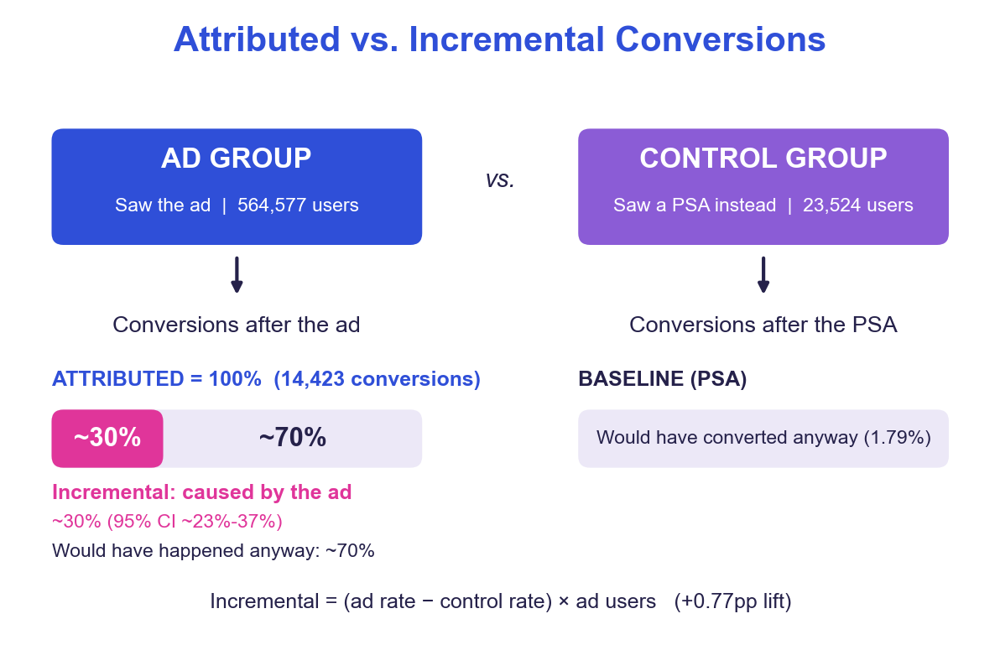

# Analyzing an Unbalanced A/B Test: Attributed vs. Incremental Conversions

> **Status: work in progress.** I'm building this analysis step by step as I learn A/B testing, and I'll write it up when it's done. The notebook is partly complete, and the write-up below describes the planned final analysis. I expect to finish it this weekend.
>
> | Step | Status |
> |---|---|
> | Clean and check the data | Done |
> | Group sizes and covariate balance | Done |
> | Lift, z-test, analytic and bootstrap CIs | Done |
> | Logistic regression check | In progress |
> | Attributed vs. incremental conversions | To do |
> | Power / minimum detectable effect | To do |
> | Segments (Holm-corrected) | To do |
> | Final write-up | To do |

Ad platforms count every conversion that follows an ad as caused by it, which overstates what a campaign earned and leads to overspending. A platform's conversion count and the ad's causal effect are different quantities, and the gap between them is where budget decisions go wrong. This project measures that gap on a real randomized experiment (588,101 users, ad vs. a public-service-announcement control) and analyzes it carefully: the control group is only 4% of users, so the analysis has to account for what that does to precision and what the data can and cannot show.

## Key results
*The notebook currently covers the group counts, the lift, the z-test, the analytic and bootstrap CIs, and the odds ratio. The marginal effect, incremental share, power and segment results, and the figure below, will be confirmed in the notebook as I complete those steps.*

| | Ad | PSA (control) |
|---|---|---|
| Users | 564,577 (96%) | 23,524 (4%) |
| Conversions | 14,423 | 420 |
| Conversion rate | 2.555% | 1.785% |

- **Lift:** the ad raised conversion by **+0.77pp** (95% CI 0.60 to 0.94pp, about 43% relative). Two-proportion z-test: z = 7.37, p < 0.001. A bootstrap CI agrees (0.59 to 0.94pp).
- **Logistic regression check:** `converted ~ test_group` gives an odds ratio of 1.44 (95% CI 1.31 to 1.59), and its average marginal effect is 0.77pp, matching the z-test.
- **Attributed vs. incremental:** only **~30% of attributed conversions were incremental**: about 4,343 of 14,423 (95% CI ~3,350 to 5,320, or 23% to 37% of attributed). The platform's count overstates the ad's effect by more than 3x. The other ~70% is the baseline conversion rate the PSA group shows.
- **Power:** with 23,524 control users, the smallest lift the design could detect at 80% power and alpha 0.05 is about **0.26pp**, so the observed 0.77pp lift is about 3x that.
- **Segments (descriptive):** after a Holm correction across 11 segment tests, the lift is clearly positive for the heaviest viewers (28+ ads, about +3pp) and on Monday, Tuesday and Wednesday, and not distinguishable from zero elsewhere. Total ads and day are measured after assignment, so this describes where the lift shows up, not a causal subgroup effect.

## Approach
- **Clean and check:** no missing values and no duplicate users; group sizes and covariate balance reviewed.
- **Primary result:** two-proportion z-test with an analytic 95% CI, plus a bootstrap CI on the lift as a robustness check.
- **Second method:** logistic regression, to confirm the z-test result by a different route.
- **Incrementality:** incremental conversions = (ad rate - control rate) x ad users; attributed = all conversions in the ad group. Uncertainty comes from the bootstrap CI, and the share's CI was cross-checked by bootstrapping the share directly.
- **Design note:** the 96/4 split is treated as deliberate. A small control group costs precision (it sets the width of the CI), not validity, if assignment was random.
- **Analysis plan:** primary metric, test and segments are written down in the notebook. It was written after the overall conversion rates were already known, so it is a plan, not a true pre-registration.

## Limits
- **Control saw a PSA, not no ad.** The estimate is the ad's effect relative to a PSA.
- **Unknown data origin.** How the data was collected and how users were assigned is not documented.
- **Assignment and interference are assumed, not verified.** Random assignment and no spillover between users cannot be confirmed from the data, and the balance checks use columns measured after assignment.
- **No sample ratio mismatch test.** The intended split is not documented, so it cannot be tested.
- **One outcome.** Only conversion is measured.
- **No cost data, so no ROI.**
- **Segments are descriptive,** not causal subgroup effects.

## Run it
1. Save the [Kaggle "Marketing A/B Testing" CSV](https://www.kaggle.com/datasets/faviovaz/marketing-ab-testing) as `data/raw/marketing_AB.csv`
2. `pip install -r requirements.txt` (Python 3.11+)
3. Run `ab_test_analysis.ipynb` top to bottom (about 2 minutes; the bootstrap is the slow part). Seeds are fixed, so results reproduce. The notebook is still being built, so it currently stops partway through the analysis.

## Stack
Python · pandas · NumPy · SciPy · statsmodels · matplotlib · seaborn · Jupyter
